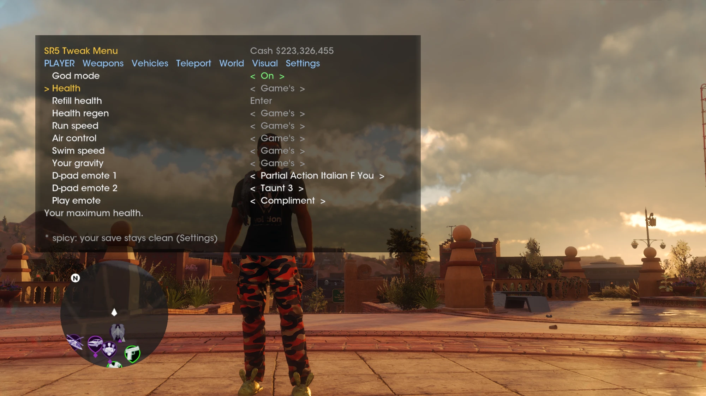

# SR5 Tweak Menu

An in-game cheat menu for **Saints Row (2022)** on PC (Epic build, DirectX
12): the [SR Tweak Menu](https://github.com/00xJS/SR-Tweak-Menu) idea from
Saints Row 1, brought to the reboot. Work in progress.

## Install

1. Download this repository (**Code > Download ZIP**) and unzip it.
2. Build the host: run `host\build.bat` (needs Visual Studio 2022 with
   **Desktop development with C++**).
3. Run `install.bat`. Give it the game's `sr5` folder as an argument if the
   game isn't in Epic's default folder. It puts `dinput8.dll` (the host) next
   to `SaintsRow_DX12.exe` and the menu in `sr5\TweakMenu\SRTweakMenu\`
   (an existing `mod.ini` is kept).
4. Start the game from Epic with **DirectX 12**. The DirectX 11 and Vulkan
   versions aren't supported yet: with them the menu stays off and the game
   runs as normal.
5. In game, open the menu:
   - **Keyboard:** F5
   - **Xbox controller:** hold RB and press D-pad Down

To uninstall, delete `sr5\dinput8.dll` and the `sr5\TweakMenu` folder.

## Controls

| | Keyboard | Xbox controller |
|---|---|---|
| Open / close menu | F5 | RB + D-pad Down |
| Move | Up / Down | D-pad Up / Down |
| Change value / browse list | Left / Right | D-pad Left / Right |
| Select | Enter | A |
| Change tab | PgUp / PgDn | LB / RB |
| Open a page | Enter | A |
| Back a page / close | Backspace | B |

While the menu is open its keys and the controller's buttons don't reach the
game; the sticks still do, so you can keep moving and looking around. The
controller is read through XInput: a PlayStation controller works when it
shows up as an Xbox one (Steam Input, DS4Windows).

## Features

Every row in the menu, tab by tab, in the menu's order. **Bold** names are
pages: Enter opens one, Backspace or B comes back. Every row has a help line
in the menu.

### Player
- **Health and survival:** God mode (the game's own health floor, not its cheat), Health (x2 to x10),
  Refill health, Health regen (none, fast, always full), No fall damage, No ragdoll, Bulletproof,
  Explosion-proof, Crash-proof, No flinch, Dodge safe time, Get up, Kill yourself
- **Movement:** Run speed (up to x5), Jump height (up to x10), Air control, Swim speed, Your gravity,
  No clip (controller: left stick, RT up, LT down, click the stick for fast; keyboard: W A S D, Space, Ctrl, Shift), Movement style, Walk style, Wounded walk, Swim on land, Always crouch, Wind, No shoving, Double jump, Jetpack, Air dash, Ice floor, Air momentum, Ragdoll yourself, Your size, Moon mode, Always sprint
- **Wingsuit:** Wingsuit boosts (the game gives one until you land: every 2 s or unlimited), Wingsuit boost power, Wingsuit top speed,
  Wingsuit glide (floaty, level, climb: pull back to go up), Wingsuit from low down, Wingsuit bounce, Glide to nearest car, Wingsuit now
- **Flow and abilities:** All perks on, Equip any skill, Effect on you (Berserker, Transfusion, Tough Mother and more), Unlimited Flow, Free skills, Flow gain, Extra Flow bars,
  Flow never drains, Rampage at full Flow, Takedown cooldown, Takedown ready now, Grenade takedown, Takedowns always kill, Short takedowns only, No takedowns, Dustlander takedowns, Skills recharge at once, Immune to, Any perk (any of the game's perk classes), Perk strength, My perks off
- **Emotes and voice:** D-pad emote 1 and D-pad emote 2 (swap the emotes on your D-pad, then use it as
  usual), Play emote, Hidden emote (ones the game never lists), Repeat emote, Freeze emote, Stop emote, Facial
  expression, Your voice, Voice pitch, Say a line (the game's voice lines), Radio call from (495 voices)
- **Homies:** Summon homie, Call in Saints, Dismiss homies, Homie limit (up to 4), Quiet homies, Next homie outfit
- **Clothes and items:** Clothing slot and Clothing item (one item at a time, hats, glasses, hair, shoes and all, hidden and cut ones too), Take off this slot, What's on this slot, Any wearable (all of the game's, tattoos and makeup too), Stack that item (two hats, a suit over a suit), Item colour, Colour part, Item gloss, Eye glow, Hair colour, Beard colour, Eye colour, Skin type, Skin set, Any voice, Material slot and Item material (any of the game's materials on one item), No hide rules
- **Animations:** Any animation (over 1,000, the ones the game never uses marked), Animation mode (loop, once, hold), Animation speed (freeze, x0.1 to x10, while it plays), Stop animation, Everyone near plays it, Move like, Force state, Back on foot, Play cinematic, World idle (mime, hula hoop, smoke, sit, phone and more), Everyone near does it, Let go of world idle, Sit down, Use nearest
- **Your look:** Play as spawned person, Play as pick and Play as special pick (any character in one press), Back to yourself, You are invisible, You look on fire, Saved look (a character you saved in the game:
  body and outfit), Saved look: outfit only, No wind on clothes, Character preset, Wear any outfit, Hidden outfit (clothes the wardrobe doesn't list), Face part and Face amount (50 parts, past the sliders), Random face, Long legs, Skin effect on you, Stop skin effects, Undo my look, Take a look snapshot, Customize character (anywhere), Prank yourself (bees, noodle arms,
  toilet, cactus and more)
- **Body beyond limits:** muscle, fat, thin, chest, blend, head shape, eye, nose and mouth size plus groin, squeezed, eye spacing and mouth width past the sliders' ends, on screen only: your save keeps your real body. Back to my real body
- **Money and progress:** Give XP, Give skill points, Add cash, Free shopping, Free ventures, Start
  mission (any, on a spare save), Insurance Fraud here, Level up once, Refund all skills, Cash from kills, XP from kills, XP needed per level, Activity clocks
- **Unlocks:** Unlock EVERYTHING (all of these at once), Unlock fast travel points, Own every weapon,
  Unlock all skills, Unlock all perks, Unlock gang and homies, Unlock all clothing, Unlock everything in
  the stores, Unlock all weapon skins, Unlock all collectibles (clothing, emotes, weapons, vehicles, HQ props). DLC and Boothill
  entries included; these stay in your save

### Weapons
- **Gun tuning:** Fire rate (up to x8), Full auto (single-shot guns keep firing while you hold the
  trigger, mouse or RT), Damage (x2 to x10, or One-hit kill), Magazine (x2, x5, No reload: kept full,
  never reloads, launchers too), Reload speed (up to instant), No recoil, Perfect aim, Range, Melee lunge (none by default), Rocket speed, Hide my gun, More satchels, Rare ammo drops, Aim anywhere, Knockback,
  Friendly fire (the game's shots do nothing to anyone friendly to you; Half or Full lets them hurt), Back shot damage, Blast radius, No warm-up, No overheat, Dual wield this gun (can crash), Hold like (any gun's poses), Any gun in vehicles and surfing
- **Thrustbuster:** Throw speed (up to 10 a second, no throw animation), Thruster warm-up, Thruster fuse, Thruster power, Rocket speed
- **Special ammo:** Special ammo (fire, shock, chill, stun, bleed, disintegrate, flee, panic, blind and more: the gun in your hands),
  Car damage, People damage scale, Shield damage, Pellets, Spread, Hip fire like aiming, Recoil recovery, Shots stagger, Ragdoll on kill, Damage type, Impact effects, Fuse, Wide swings, Tracer, Muzzle flash, Shell casing, Firing shake, Special rounds (any gun fires the thruster football, RPG, boomerang poi, pinata, anvil, tank shell and 25 more), Round blast (any of 47), Rounds stick, Rounds arc, Signature effects on any gun, Explosive punches (any blast), Money gun, Teleport on shot and Portal pair, Clear portals, Black hole, Homing rounds, Shoot prop, Prop gun, Fire from (hand or head)
- **Get weapons:** Give weapon (any of the game's), Special weapon (mission-only ones), Prototype weapon, Refill all ammo
  (free), Max every weapon's upgrades, Put that gun in slot, Weapon skin, Random gun colours, Signature ability (this gun), All signature abilities, Remove this weapon, Remove test guns (the dev guns Own every weapon adds)
- Weapons back to normal

### Vehicles
- **Spawning:** From my garage (any car you own, with your paint and parts, no mechanic), Spawn vehicle (any of the game's 90 ready-to-drive vehicles, next to you), Special vehicle
  (bus, tank, yacht, VTOL, hoverboard and more), Any vehicle and Variant (all 624 versions in the game's tables, rare and reward ones too), Remove spawned vehicles, Deliver to garage
- **Handling:** Engine power, Grip, Steering, Vehicle top speed, Suspension, Ride height, Front grip, Rear grip, Drift angle, Burnout, Bike lean, Auto-flip, Ice body, Vehicle size, Tank steering, Twitchy chassis, Downforce, Vehicle gravity, Heavy vehicle, Bouncy car, Vehicle speed limit, Air drag, Spin drag, Vehicle time, Weight balance
- **Toughness:** Vehicle god mode, No collision damage, Bulletproof tires, Keep vehicle repaired, Destroy
  this vehicle
- **Aircraft and boats:** Aircraft speed, VTOL boost, Helicopter agility, Helicopter lift, Boat speed, Floats on water, Never sink, Flight mode (helicopter, fixed-wing, VTOL)
- **Boost and damage:** Boost tank, Boost refill, Boost power, Launch strength, Engine fire at, Fire burn speed, World crash scale, Stay on bike
- **Upgrades and parts:** Vehicle upgrade and Upgrade level, Rims, Tires, Any paint, Underglow colour and brightness, Off-road kit anywhere, Part slot and Part (every slot on the vehicle you're in, locked ones too), Paint area and Paint colour, Pattern area and Pattern, Colour material and Any colour
- **Hover vehicles:** Hover rise and lower (on the Prototype RTP: hold B to rise, X to lower), Hover top speed, Hover height, Hover jump, Hover guns (hold RT to fire)
- **Abilities and combat:** Vehicle ability (jump, ball and chain, ejector seats, crab steering and more,
  on most vehicles), Fire, Stop and Remove that ability, Tow hook, Drop tow hook, Make nearest car towable, Crab steering, Air control and Honk blast strength, Bowelrod launch, Windshield launch, Boost now, Launch start, Stick nearest car on me, Unstick car, Back on the road, Effect on this car (slippery, super grip, plow and more), Launch this vehicle, Jump this vehicle, Surf nearest car, Stop surfing, Surf faster cars, Surf autopilot, Surfing is safe, Hoverboard slam, Vehicle jump power, No ability cooldowns, Ram
  power, Crusher, Takedowns at any speed, Ejector cannon, Cowcatcher launch, Fire vehicle's guns (hold R3 or G), Shoot from any seat, Swap mount (can crash)
- **Look and camera:** Next paint, Brake lights stay on, Wheel size, Underglow, Headlights on, Any horn, Any engine sound, Always tire marks, Always tire smoke, Car camera resets after, Free camera in cars, Car camera follows the nose, Car camera field of view, Car camera far, Camera through walls

### Teleport
- Go to waypoint, Auto-teleport to waypoint, Warp from map (the game's dev teleport on the big map), Store and Map place (what the map knows), Fast travel point
  (the game's 44), Teleport style (Instant, with no loading screen, or the game's)
- **Saved places:** Save this spot, Go to, Delete that place
- Go up (10 m to 3000 m), Where am I

### World
- **Time and weather:** Game speed (slow motion to x4), Slow motion button (hold LB and RB, or Alt), Weather (all: every weather the game has), That weather, instantly, Weather as indoors, Freeze clock, Clock speed, Go to time, Pause world, Only you move
- **Developer switches:** never die, Shawn mode, capture mode, auto sprint, infinite ammo and magazine and more, left in the game by its developers
- **Spawn people:** Spawn person (any of the game's 834 characters), Special person (bosses, ghosts,
  skeletons, mascots, a coyote), Spawned people (passive, bodyguards, your army or fight you), Spawned people carry, Spawn a crowd (ten
  around you), Spawn 10 random people, Call in follower, Spawned people get in my car, Spawned people go to waypoint, Remove spawned people
- **Everyone near:** Everyone near (cheer, laugh, taunt and more), Status on everyone near (flee, shock, panic, blind, chill and more), Make everyone near follow you, Everyone
  near dance, Make everyone near friendly or hostile, Disarm and Re-arm everyone near, Stun, Ragdoll,
  Float, Set on fire, Dissolve, Poison and Kill everyone near, Stop fights near, Revive everyone near, Strip shields near, Make everyone near tough,
  Everyone near staggers easily, Fade out and back in, Everyone near says it, Order everyone near (any of the game's 129 AI orders), Face on everyone near, Statues and back, Flaming look near, Put out everyone near, Blow up cars near, Set off car alarms, Sirens on near, Spin cars near, Everyone out of their cars, Cars near floor it, Status stays on everyone near, Status stays on me, Status stays: off, Knock everyone near down
- **Notoriety and gangs:** Never wanted (by anyone, by police: no cops, or by gangs), Enemy aim, Send in a gang, Stay in combat, Notoriety forgets
  fast, Wanted climbs fast, Escape radius, No reinforcements, No roadblocks, Roadblock mania, Pursuit cars, Enemies arrive, Call-in speed, No ramming, Chase speed, Enemies always find you, Enemies flee fights, Non-lethal enemies, Riot shields for all, Enemies use smoke, Swarm, Unseen by AI, Enemy sight, Notoriety at least, Notoriety at most, No notoriety cap, Can't lose them, Gangs and police without guns, Gang on your
  side, Saints are enemies, Send in a wave
- **Gang war:** Gang war (Panteros, Idols, Marshall and police fight each other), Zombie outbreak, Riot, Free for all, Gang presence, Downed, not dead, NPC fight damage, Pedestrians fight back, Everyone battle ready, Downed timer, Instant revive, Guardian angel, Spawned people can't die
- **Physics and explosions:** No world boundary, World gravity, Explosion here, Blast at waypoint, Airstrike, Size of everything near, Explosion size, Explosion force, Explosion damage, Hurting yourself, Knocked over, Launch everyone near, Stagger cooldown
- **Population:** Pedestrians, Traffic, Rare traffic, Traffic mood, Traffic light here, Any district's crowd, Traffic spacing, Corpses stay, Long trains, No trains, Traffic pop-in, People appear, Quiet streets, Crowds in the rain, People panic, No parked cars, Street scene, Street scenes normal, Bigger squads, Elites early
- **Music:** Radio station (premium ones too), Music anywhere (on foot too), Play song (any song, three no station plays), Next and Previous station, Unlock radio in missions, Radios in cars near me, Radio on foot, Shuffle playlists, Master, Music, Effects and Voice volume, a volume for each of the game's 11 sound groups, City panic noise, Play sound (the game's sound events), Skip track, Pause or resume music, Now playing, Newscast, Stop newscast
- **Props and HQ:** Spawn prop, Remove last prop, Remove all props, HQ spot, HQ prop (any prop, owned or not, on any spot in your headquarters, from anywhere), Clear this HQ spot, Fill the HQ, Save HQ layout, Load HQ layout, HQ room theme, Standing turret
- **Engine values:** Engine system, class, record and field (about 1,500 of the game's numbers and 900 on/off flags across 313 classes), Engine list item (all of a list or one), Engine amount, Change this record, Change all records, Undo all engine changes
- **Side jobs:** Start diversion, Hermit juice, Insurance Fraud launch, Fraud scoring, Give reward, Fast travel off, Venture lot, Build venture here, Load and Unload hidden place
- **People near, more:** People speed, Gravity near, Drop through the ground, Fake noise, Drivers bolt, Any goal set near, Hunted, Crowd around me, Taunt them, Shoot at me (each with a stop), Cars near pull over, Drivers weave, Drivers stay in, Off and Back on the minimap, Outline people near, Clear outlines, Skin effect near, Reeling near, Take down nearest, Delete everyone near
- **Cars near:** Freeze and Unfreeze cars near, Launch cars near, Pop tires near, Stall engines near, Engines back on, Cars near do (J-turn, hairpin, ram, ramp mode), Cars near back to normal, Hazards near, Lock and Unlock cars near, Pop trunks near, Crush cars near, Tip bikes near, Ghost through cars near, Solid cars near, Delete nearest car
- **Money and drops:** Drop cash, Drop weapon, Money rain, Pedestrians always pay, Venture income
- **Difficulty:** the custom difficulty sliders (player health, player damage, enemies, vehicles,
  notoriety, ammo reserve, timer speed)
- Empty streets (no people or traffic), Show activities on the map

### Visual
- **Camera:** Field of view, Camera distance (first person to very far), Shoulder camera (centred, right,
  left), Turn speed (past the options' top), Camera shake, Looping camera shake, Camera bobbing, Photo
  mode (the game's own free camera), Free camera (fly the camera while you stay put)
- **Screen:** Depth of field, Shift view, Colour vision filter, Brightness, Hide from view (sky, particles, shadows, far trees), Low health screen, Show
  only people, Blackout, Minimap size, High contrast, HUD style, Crosshair size, Blacklight world, Tracer colours, Radial blur, Tunnel vision, Aim blur, Censor mosaic, World material, Screen tint, Camera effects, All caps text, Letterbox, Hide HUD, Video on screens, Video off, Fake objective

- **Sky and atmosphere:** Fog, Haze, Sky exposure, God rays, Ambient light, Bounced light, Sun size, Moon size, Star brightness, Cloud cover, Rain amount, Heat haze, Wind speed, Sun speed, Film grain, Sky vignette, Sky, Sun, Moon, Fog and Star colour, Sun position, Lock exposure, Lamps on, Any sky setting (over 300 of the game's own), Sky amount, Clear sky settings

### Cheats
The game's own phone cheats, all together.
- **Player:** Invincibility, Give cash, Max level, Super Saints, Milk Bones, Pratfall, Heaven Bound
- **Weapons:** Infinite ammo, Golden gun
- **Vehicles:** Repair vehicle, Drop a car, Infinite boost, Infinite mass, No traffic laws
- **Traffic:** Monster truck traffic, Luxury traffic, Mascots
- **World:** Weather, Time of day, Screen filter (black & white, retro, night vision, old-timey, vapor,
  western, steamboat), Low gravity, Angry pedestrians
- **Notoriety:** raise, clear or max it with the Police, Idols, Marshal and Los Panteros

### Settings
- Save tweaks for next time
- **Game:** Skip intro, Skip cutscene, Pause / resume cutscene, Quick save, New save, No autosave, Load last save, Tutorial popups
- **Menu:** All tweaks (the master switch), Hold Back opens the menu, Keep my save clean, Menu opacity
- What's on (every tweak and cheat that's on), Turn every cheat off, Everything back to normal, Forget
  saved tweaks, Close menu

Cheats and tweaks start off (Keep my save clean starts on). Tweaks stay as you set them until you quit;
**Settings > Save tweaks for next time** keeps them for the next start (`sr5\TweakMenu\saved_tweaks.txt`); saved places are in
`sr5\TweakMenu\saved_places.txt`. Rows marked experimental in their help
line still need a test in play.

## Settings

Every number is in `sr5\TweakMenu\SRTweakMenu\mod.ini`: the key that opens
the menu, where it's drawn and how big, rows shown at once, the panel's
opacity and Keep my save clean. Restart the game after changing them.

## Notes

- **Your save.** Rows marked `*` are the game's "spicy" cheats: in the game,
  using one marks your save as cheated and pauses achievements. With
  **Settings > Keep my save clean** (on by default) the menu lets them run
  without marking the save; achievements pause only while a spicy cheat is
  on. Nothing outside the game's cheats (god mode, weapons, teleport) touches
  that at all.
- **Weapon tweaks** change the game's own weapon data, shared with everyone
  who carries that weapon: fire rate, magazines and one-hit kill apply to
  enemies' guns too (x2 to x10 damage doesn't). Pair them with God mode.
- Single player only.
- The repository contains no game files.

## How it works

**The host (`host/host.c`, built as `dinput8.dll`)**

- **Loading.** The game imports one function from `dinput8.dll`, so Windows
  loads the host from the game folder. Calls go on to a copy of the system
  DLL (`TweakMenu\dinput8_system.dll`): the Epic overlay hooks any
  `dinput8.dll`'s `DirectInput8Create` and would send the call back here.
- **Frames.** The game's main loop calls one function three times an
  iteration on the main thread; the host detours it and runs the menu's
  Lua 5.4 on the first call, about 60 times a second.
- **The game's Lua.** The game has one Lua 5.1 state, its interface's.
  `wml.game(code)` loads and runs code in it with the game's own
  `lua_load` and `lua_pcall` and returns the results. The game's Lua has
  no string, table or math library and a small memory pool.

**The menu (`SRTweakMenu/`)**

| File | What it is |
|---|---|
| `main.lua` | Runs the menu every frame; the live probe |
| `menu.lua` | Tabs, rows, input |
| `cheats.lua` | The game's cheats: the list, their state, switching them, keeping the save clean |
| `weapons.lua` | Weapon tweaks on the game's weapon data (fields, property lists, defaults) |
| `player.lua` | Health, movement, position, teleport, saved places, spawning, the car you're in |
| `tweaks.lua` | Settings kept for next time |
| `world.lua` | The clock (freeze, speed), pausing the world, notoriety |
| `wingsuit.lua` | Wingsuit tweaks (its data and your live copy) |
| `camera.lua` | Camera turn speed |
| `vdata.lua` | Shared: field addresses in the game's reflection data |
| `vehicles.lua` | Every vehicle and variant in the game's tables, generated |
| `perks.lua` | The game's perk classes that its code reads, generated |
| `sounds.lua` | Sound event names from the game's audio tables, generated |
| `sky.lua` | The game's time-of-day settings and ranges, generated |
| `anims.lua` | The game's animation tags in always-loaded sets, generated |
| `clothes.lua` | The game's wearables with a model, by slot, generated |
| `rounds.lua` | Projectiles any gun can fire and every blast, generated |
| `browser.lua` | The game's records, numeric fields and flags by system, for Engine values, generated |
| `shots.lua` | Rows that act on your shots: teleport, portals, black hole, homing, prop gun, dual wield |
| `cars.lua` | Vehicle parts, paint, guns, seats, physics and flight mode |
| `extras.lua` | Name lists for the weapon swaps and world rows, generated |
| `gameui.lua` | Draws the menu with the game's interface (vint text objects) |
| `luadump.lua` | Development: reads a game Lua function's constants from memory |

The `wml` table the Lua sees has the same shape as the SR1 menu's host:
`log`, `setting`, `read_*`/`write_*` (64-bit addresses),
`key_down`, `key_pressed`, `on_frame`, `pad`, plus `game(code)`,
`call(addr, ...)`, `buffer`, `read_string` and `base` (the executable's
load address).

**Testing**

- **Live probe.** Set `dev_probe = true` in the installed `mod.ini`. While the
  game runs, anything written to `sr5\TweakMenu\probe_in.lua` is run in the
  menu's Lua (with `game` and `dump` at hand), and what it prints goes to
  `sr5\TweakMenu\probe_out.txt`.
- **Research.** `research/` holds what was found in the game (addresses,
  the game's Lua globals, its interface functions) and `tools/` the Python
  scripts used to find it (they read `SaintsRow_DX12.exe` and the running
  game; `pip install pefile capstone numpy`). `tools/vpp.py` lists and
  extracts the game's `.vpp_pc` archives (its interface Lua is plain source
  there); what it extracts stays out of git. `tools/rcls.py` prints a
  reflection class's fields with offsets, `tools/vtbl.py` finds a class's
  vtable.

## Credits

- SR Tweak Menu by 00xJS. Saints Row by Volition.
- Lua 5.4.9 by PUC-Rio, MIT licensed (`third_party/lua-5.4.9`).

SR5 Tweak Menu's own code is MIT licensed, see `LICENSE`.
