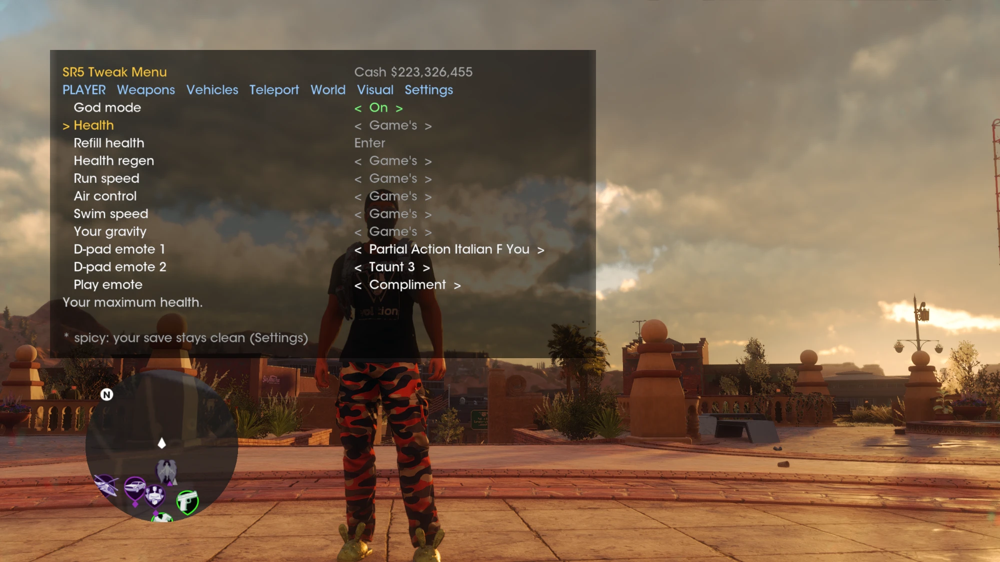

# SR5 Tweak Menu

An in-game cheat menu for **Saints Row (2022)** on PC (Epic build, DirectX
12): the [SR Tweak Menu](https://github.com/00xJS/SR-Tweak-Menu) idea from
Saints Row 1, brought to the reboot. Work in progress.

## Install

1. Download this repository (**Code > Download ZIP**) and unzip it.
2. Build the host: run `host\build.bat` (needs Visual Studio 2022 with
   **Desktop development with C++**).
3. Run `install.bat`. Give it the game's `sr5` folder as an argument if the
   game isn't in Epic's default folder. It puts `dinput8.dll` (the host) next
   to `SaintsRow_DX12.exe` and the menu in `sr5\TweakMenu\SRTweakMenu\`
   (an existing `mod.ini` is kept).
4. Start the game from Epic with **DirectX 12**. The DirectX 11 and Vulkan
   versions aren't supported yet: with them the menu stays off and the game
   runs as normal.
5. In game, open the menu:
   - **Keyboard:** F5
   - **Xbox controller:** hold RB and press D-pad Down

To uninstall, delete `sr5\dinput8.dll` and the `sr5\TweakMenu` folder.

## Controls

| | Keyboard | Xbox controller |
|---|---|---|
| Open / close menu | F5 | RB + D-pad Down |
| Move | Up / Down | D-pad Up / Down |
| Change value / browse list | Left / Right | D-pad Left / Right |
| Select | Enter | A |
| Change tab | PgUp / PgDn | LB / RB |
| Open a page | Enter | A |
| Back a page / close | Backspace | B |

While the menu is open its keys and the controller's buttons don't reach the
game; the sticks still do, so you can keep moving and looking around. The
controller is read through XInput: a PlayStation controller works when it
shows up as an Xbox one (Steam Input, DS4Windows).

## Features

Every row in the menu, tab by tab, in the menu's order. **Bold** names are
pages: Enter opens one, Backspace or B comes back. Every row has a help line
in the menu.

### Player
- **Health and survival:** God mode (the game's own health floor, not its cheat), Health (x2 to x10),
  Refill health, Health regen (none, fast, always full), No fall damage, No ragdoll, Bulletproof,
  Explosion-proof, Crash-proof, Kill yourself
- **Movement:** Run speed (up to x5), Jump height (up to x10), Air control, Swim speed, Your gravity,
  No clip (W A S D, Space, Ctrl, Shift), Movement style, Walk style
- **Wingsuit:** Wingsuit boosts (every 2 s or unlimited), Wingsuit boost power, Wingsuit top speed,
  Wingsuit glide (floaty, level, climb), Wingsuit from low down
- **Flow and abilities:** All perks on, Unlimited Flow, Free skills, Flow gain, Extra Flow bars,
  Flow never drains, Rampage at full Flow, Takedown cooldown
- **Emotes and voice:** D-pad emote 1 and D-pad emote 2 (swap the emotes on your D-pad, then use it as
  usual), Play emote, Hidden emote (ones the game never lists), Repeat emote, Stop emote, Facial
  expression, Your voice, Voice pitch, Say a line (the game's voice lines)
- **Homies:** Summon homie, Call in Saints, Dismiss homies, Homie limit (up to 4)
- **Your look:** Play as spawned person, Back to yourself, Saved look (a character you saved in the game:
  body and outfit), Character preset, Customize character (anywhere), Prank yourself (bees, noodle arms,
  toilet, cactus and more)
- **Money and progress:** Give XP, Give skill points, Add cash, Free shopping, Free ventures, Start
  mission (any, on a spare save), Insurance Fraud here
- **Unlocks:** Unlock EVERYTHING (all of these at once), Unlock fast travel points, Own every weapon,
  Unlock all skills, Unlock all perks, Unlock gang and homies, Unlock all clothing, Unlock everything in
  the stores, Unlock all collectibles (clothing, emotes, weapons, vehicles, HQ props). DLC and Boothill
  entries included; these stay in your save

### Weapons
- **Gun tuning:** Fire rate (up to x8), Full auto (single-shot guns keep firing while you hold the
  trigger, mouse or RT), Damage (x2 to x10, or One-hit kill), Magazine (x2, x5, No reload: kept full,
  never reloads, launchers too), Reload speed (up to instant), No recoil, Perfect aim, Range, Knockback,
  No warm-up, No overheat
- **Special ammo:** Special ammo (fire, shock, chill, stun, bleed, disintegrate: the gun in your hands),
  Money gun
- **Get weapons:** Give weapon (any of the game's), Special weapon (mission-only ones), Refill all ammo
  (free), Max every weapon's upgrades, Remove this weapon
- Weapons back to normal

### Vehicles
- **Spawning:** Spawn vehicle (any of the game's 90 ready-to-drive vehicles, next to you), Special vehicle
  (bus, tank, yacht, VTOL, hoverboard and more), Remove spawned vehicles, Deliver to garage
- **Handling:** Engine power, Grip, Steering, Vehicle top speed, Suspension, Vehicle gravity, Heavy vehicle
- **Toughness:** Vehicle god mode, No collision damage, Bulletproof tires, Keep vehicle repaired, Destroy
  this vehicle
- **Abilities and combat:** Vehicle ability (jump, ball and chain, ejector seats, crab steering and more,
  on any vehicle), Tow hook, Boost now, Jump this vehicle, Vehicle jump power, No ability cooldowns, Ram
  power, Takedowns at any speed
- **Look and camera:** Next paint, Brake lights stay on, Car camera resets after, Free camera in cars

### Teleport
- Go to waypoint, Auto-teleport to waypoint, Store and Map place (what the map knows), Fast travel point
  (the game's 44)
- **Saved places:** Save this spot, Go to, Delete that place
- Go up (10 m to 3000 m), Where am I

### World
- **Time and weather:** Weather (all: every weather the game has), Freeze clock, Clock speed, Pause world
- **Spawn people:** Spawn person (any of the game's 834 characters), Special person (bosses, ghosts,
  skeletons, mascots, a coyote), Spawned people (passive, bodyguards or fight you), Spawn a crowd (ten
  around you), Spawn 10 random people, Remove spawned people
- **Everyone near:** Everyone near (cheer, laugh, taunt and more), Make everyone near follow you, Everyone
  near dance, Make everyone near friendly or hostile, Disarm and Re-arm everyone near, Stun, Ragdoll,
  Float, Set on fire, Dissolve, Poison and Kill everyone near, Blow up cars near
- **Notoriety and gangs:** Never wanted (by anyone, by police: no cops, or by gangs), Notoriety forgets
  fast, No reinforcements, No roadblocks, Can't lose them, Gangs and police without guns, Gang on your
  side, Saints are enemies
- **Money and drops:** Drop cash, Drop weapon, Money rain
- **Difficulty:** the custom difficulty sliders (player health, player damage, enemies, vehicles,
  notoriety, ammo reserve, timer speed)
- Empty streets (no people or traffic), Show activities on the map

### Visual
- **Camera:** Field of view, Camera distance (first person to very far), Shoulder camera (centred, right,
  left), Turn speed (past the options' top), Camera shake, Looping camera shake, Camera bobbing, Photo
  mode (the game's own free camera)
- **Screen:** Brightness, Hide from view (sky, particles, shadows, far trees), Low health screen, Show
  only people, Letterbox, Hide HUD

### Cheats
The game's own phone cheats, all together.
- **Player:** Invincibility, Give cash, Max level, Super Saints, Milk Bones, Pratfall, Heaven Bound
- **Weapons:** Infinite ammo, Golden gun
- **Vehicles:** Repair vehicle, Drop a car, Infinite boost, Infinite mass, No traffic laws
- **Traffic:** Monster truck traffic, Luxury traffic, Mascots
- **World:** Weather, Time of day, Screen filter (black & white, retro, night vision, old-timey, vapor,
  western, steamboat), Low gravity, Angry pedestrians
- **Notoriety:** raise, clear or max it with the Police, Idols, Marshal and Los Panteros

### Settings
- Save tweaks for next time
- **Game:** Skip cutscene, Pause / resume cutscene, Quick save, Load last save, Tutorial popups
- **Menu:** All tweaks (the master switch), Hold Back opens the menu, Keep my save clean, Menu opacity
- What's on (every tweak and cheat that's on), Turn every cheat off, Everything back to normal, Forget
  saved tweaks, Close menu

Cheats and tweaks start off (Keep my save clean starts on). Tweaks stay as you set them until you quit;
**Settings > Save tweaks for next time** keeps them for the next start (`sr5\TweakMenu\saved_tweaks.txt`); saved places are in
`sr5\TweakMenu\saved_places.txt`. Rows marked experimental in their help
line still need a test in play.

## Settings

Every number is in `sr5\TweakMenu\SRTweakMenu\mod.ini`: the key that opens
the menu, where it's drawn and how big, rows shown at once, the panel's
opacity and Keep my save clean. Restart the game after changing them.

## Notes

- **Your save.** Rows marked `*` are the game's "spicy" cheats: in the game,
  using one marks your save as cheated and pauses achievements. With
  **Settings > Keep my save clean** (on by default) the menu lets them run
  without marking the save; achievements pause only while a spicy cheat is
  on. Nothing outside the game's cheats (god mode, weapons, teleport) touches
  that at all.
- **Weapon tweaks** change the game's own weapon data, shared with everyone
  who carries that weapon: fire rate, magazines and one-hit kill apply to
  enemies' guns too (x2 to x10 damage doesn't). Pair them with God mode.
- Single player only.
- The repository contains no game files.

## How it works

**The host (`host/host.c`, built as `dinput8.dll`)**

- **Loading.** The game imports one function from `dinput8.dll`, so Windows
  loads the host from the game folder. Calls go on to a copy of the system
  DLL (`TweakMenu\dinput8_system.dll`): the Epic overlay hooks any
  `dinput8.dll`'s `DirectInput8Create` and would send the call back here.
- **Frames.** The game's main loop calls one function three times an
  iteration on the main thread; the host detours it and runs the menu's
  Lua 5.4 on the first call, about 60 times a second.
- **The game's Lua.** The game has one Lua 5.1 state, its interface's.
  `wml.game(code)` loads and runs code in it with the game's own
  `lua_load` and `lua_pcall` and returns the results. The game's Lua has
  no string, table or math library and a small memory pool.

**The menu (`SRTweakMenu/`)**

| File | What it is |
|---|---|
| `main.lua` | Runs the menu every frame; the live probe |
| `menu.lua` | Tabs, rows, input |
| `cheats.lua` | The game's cheats: the list, their state, switching them, keeping the save clean |
| `weapons.lua` | Weapon tweaks on the game's weapon data (fields, property lists, defaults) |
| `player.lua` | Health, movement, position, teleport, saved places, spawning, the car you're in |
| `tweaks.lua` | Settings kept for next time |
| `world.lua` | The clock (freeze, speed), pausing the world, notoriety |
| `wingsuit.lua` | Wingsuit tweaks (its data and your live copy) |
| `camera.lua` | Camera turn speed |
| `vdata.lua` | Shared: field addresses in the game's reflection data |
| `gameui.lua` | Draws the menu with the game's interface (vint text objects) |
| `luadump.lua` | Development: reads a game Lua function's constants from memory |

The `wml` table the Lua sees has the same shape as the SR1 menu's host:
`log`, `setting`, `read_*`/`write_*` (64-bit addresses),
`key_down`, `key_pressed`, `on_frame`, `pad`, plus `game(code)`,
`call(addr, ...)`, `buffer`, `read_string` and `base` (the executable's
load address).

**Testing**

- **Live probe.** Set `dev_probe = true` in the installed `mod.ini`. While the
  game runs, anything written to `sr5\TweakMenu\probe_in.lua` is run in the
  menu's Lua (with `game` and `dump` at hand), and what it prints goes to
  `sr5\TweakMenu\probe_out.txt`.
- **Research.** `research/` holds what was found in the game (addresses,
  the game's Lua globals, its interface functions) and `tools/` the Python
  scripts used to find it (they read `SaintsRow_DX12.exe` and the running
  game; `pip install pefile capstone numpy`). `tools/vpp.py` lists and
  extracts the game's `.vpp_pc` archives (its interface Lua is plain source
  there); what it extracts stays out of git. `tools/rcls.py` prints a
  reflection class's fields with offsets, `tools/vtbl.py` finds a class's
  vtable.

## Credits

- SR Tweak Menu by 00xJS and itsMJQ. Saints Row by Volition.
- Lua 5.4.9 by PUC-Rio, MIT licensed (`third_party/lua-5.4.9`).

SR5 Tweak Menu's own code is MIT licensed, see `LICENSE`.
